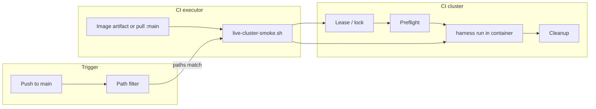

# Storage certification harness — CI/CD live cluster smoke test

## Status

Proposed (2026-10-12)

## Summary

Define how the `storage-cert-harness` repository runs an **automated live-cluster
smoke** after changes land on `main`, using
`plans/harness-smoke-plan.yaml` (expanded to full catalog coverage) and portable
CI scripts (`run-image-tests.sh` and successors). The smoke runs **every
automated test requirement in** `catalog.json` at reduced scale, except the HA
test and any test that cannot complete within **20 minutes** per TR at those
smoke settings. It is a **merge gate for harness quality**, not a certification
run.

Image build and publish remain the existing `ci-images` / `ci-publish` path on
`main`. Live smoke is a **separate job** that consumes the built image (or builds
once on a cluster-capable runner) and fails on harness errors or unexpected test
failures.

## Goals and non-goals

| Goals                                                                                        | Non-goals                                                      |
| -------------------------------------------------------------------------------------------- | -------------------------------------------------------------- |
| Catch regressions across **all** catalog automations (smoke scale) on a real OCP+CNV cluster | Full Level-3 certification scale or HA/fencing (`TR-VIRT-007`) |
| Run only when `main` changes in ways that affect executable behavior                         | Running on every docs or CI-script-only change                 |
| Exclusive, safe use of a shared or dedicated CI cluster                                      | Storing real threshold bars or kubeconfig in git               |
| Deterministic preflight, minimal plan params, cleanup on all exit paths                      | Publishing graded reports with partner SLA secrets             |

## Related work and Jira traceability

| Jira                                                                   | Summary                                         | Design coverage                                                      |
| ---------------------------------------------------------------------- | ----------------------------------------------- | -------------------------------------------------------------------- |
| [ECOPROJECT-5406](https://redhat.atlassian.net/browse/ECOPROJECT-5406) | Live cluster smoke + image on merge to `main`   | Sections 1, 3–8; full-catalog smoke plan (see **Drift** below)       |
| [ECOPROJECT-5462](https://redhat.atlassian.net/browse/ECOPROJECT-5462) | Hosted runners for cluster smoke                | Section 2 — **optional**; see **When ECOPROJECT-5462 is not needed** |
| [ECOPROJECT-5536](https://redhat.atlassian.net/browse/ECOPROJECT-5536) | Opt-out: skip live smoke from PR / merge commit | Section 1 — **Skip live smoke**; `docs/ci.md`, PR template           |

### ECOPROJECT-5536: skip live smoke on demand

[Jira: ECOPROJECT-5536](https://redhat.atlassian.net/browse/ECOPROJECT-5536) —
sub-task of [ECOPROJECT-5488](https://redhat.atlassian.net/browse/ECOPROJECT-5488).
Long smoke should not block every `main` push (~2+ hours end-to-end when smoke
runs). Documented in `storage-cert-harness/docs/ci.md` and
`.github/pull_request_template.md`.

#### Scope

- Recognize an opt-out token in the **commit message** that lands on `main` (squash
merge commit message = PR title/body — document where contributors put the token).
- Skip the `live-smoke` job only; lint, unit test, build, image scan, and publish
continue unchanged unless a separate gate says otherwise.
- Emit a clear log line and GitHub check conclusion **Skipped** (not **Success**),
and surface skip in the workflow summary (SHA, actor, token used).
- Restrict who may skip (optional): only org members, or require `storage-cert-harness`
maintainer — fork pushes to `main` are already impossible on protected branches.

#### Acceptance criteria

- Push to `main` whose **head commit message** contains `[skip live-smoke]` does
not start cluster work (job skipped or not created).
- Push without the token still runs live smoke when path filters match.
- Token is case-sensitive and documented in `docs/ci.md` and PR template.
- Skipped runs do not hold the cluster lease.
- Audit: workflow run records `live_smoke_skipped=true` in the summary for later
nightly or manual smoke backlog.

**Suggested tokens** (pick one in implementation): `[skip live-smoke]` primary;
avoid reusing `[skip ci]` (too broad).

### Drift from ECOPROJECT-5406 description (AC implied in story body)

The Jira description still references `plans/virtbench-bootstorm-live-smoke.yaml` and
a boot-storm-only smoke. Implementation and this design use an expanded
`plans/harness-smoke-plan.yaml` aligned with
`plans/level3-internal-minimal.yaml` (all catalog TRs, smoke overrides) but
**without** `TR-VIRT-007`. Image build/push is already implemented via GitHub
Actions / GitLab CI, not a single combined shell script named `ci/live-smoke.sh`.
The design keeps **portable scripts** under `storage-cert-harness/ci/scripts/`
(e.g. extend `run-image-tests.sh` or add `live-cluster-smoke.sh`) so GitLab and
GitHub share one entry point.

### When ECOPROJECT-5462 is not needed

[ECOPROJECT-5462](https://redhat.atlassian.net/browse/ECOPROJECT-5462) targets
**GitHub-hosted runners** that can reach the cluster, with triggers on **PR →**
`main` and explicitly **not** on push to `main`. That conflicts with the
product direction in this design (**smoke only after merge to** `main`) and with
ECOPROJECT-5406 (post-merge smoke).

Treat ECOPROJECT-5462 as **out of scope** when either:

- Smoke runs on a **GitLab runner** (or other internal executor) that already has
network path to the cluster and `podman`/`oc`, or
- GitHub Actions uses a **self-hosted runner** or **runner group** with cluster
access, while default `ubuntu-latest` jobs stay unchanged.

In those cases, only ECOPROJECT-5406-style work is required: secrets, workflow
job, path filters, and cluster lease/cleanup. No separate “hosted runner”
product configuration story is needed; document runner owner and network path in
the ops runbook instead.

### ECOPROJECT-5462 acceptance criteria vs this design

| ECOPROJECT-5462 AC                         | This design                                                                                               |
| ------------------------------------------ | --------------------------------------------------------------------------------------------------------- |
| Hosted runner used only for cluster smoke  | Satisfied by dedicating a runner label / GitLab tag to the live-smoke job only                            |
| PR targeting `main` runs smoke             | **Not adopted** — smoke runs on **push to** `main` with path filters (user requirement; aligns with 5406) |
| Push to `main` does not run smoke          | **Inverted** — push to `main` **does** run smoke when paths match                                         |
| PR to non-`main` branch does not run smoke | Satisfied                                                                                                 |
| Fork PRs cannot read cluster secrets       | Satisfied via protected environments / `main`-only workflows / no `pull_request` trigger for live smoke   |
| Named owners, rotation, escalation         | Section 3 and **Operations**                                                                              |

## Architecture overview



Existing building blocks:

- Plan: `storage-cert-harness/plans/harness-smoke-plan.yaml`
- Local/CI validation and run wrapper: `ci/scripts/run-image-tests.sh`
- Published image smoke (alternate): `ci/scripts/run-quay-image-tests.sh`
- Offline replay (no cluster): `ci/scripts/replay-smoke.sh` — remains opt-in, not
a substitute for live smoke

---

## 1. When to trigger CI/CD smoke

### Event (provisional default — see [§11 Open items](#11-open-items))

| Event               | Run live smoke? (today’s design lean)                                                 |
| ------------------- | ------------------------------------------------------------------------------------- |
| Push to `main`      | Yes, if path filter matches                                                           |
| Pull request        | No automatic run (lint/unit/build/image only)                                         |
| Maintainer on-demand on PR | Not automatic; see [§11.3](#113-maintainer-on-demand-smoke-on-a-pull-request) |
| `workflow_dispatch` | Optional manual run on a chosen ref (operators / maintainers)                         |
| Nightly schedule    | Optional follow-up (5406 mentions nightly; keep off until cluster capacity is proven) |

**Provisional rationale:** cluster credentials stay on protected branches; fork
PRs must never see kubeconfig. Pre-merge confidence comes from unit tests,
replay-smoke (opt-in), and image build — not from mutating the shared cluster on
every PR. Whether that should change is an **open decision** ([§11.1](#111-when-to-run-smoke-pull-request-vs-push-to-main)).

### Forks and untrusted repositories

Live smoke must **never** run from a fork or expose upstream cluster secrets to
fork workflows. Required behavior:

| Scenario | Live smoke | `CI_CLUSTER_KUBECONFIG` / live-smoke secrets |
| --- | --- | --- |
| PR from a **fork** into upstream `main` | **Not triggered** (no `pull_request` trigger on live-smoke workflow) | **Not available** — GitHub does not pass upstream secrets to `pull_request` workflows for fork PRs |
| Push to **fork** `main` (copy of the repo) | **Not triggered** — job `if` requires canonical repository (below) | **Not available** — only secrets defined on the fork exist; upstream kubeconfig is never injected |
| Push to **upstream** `main` | Runs when path filters match (unless `[skip live-smoke]`) | Available only via `live-smoke` **environment** on upstream |
| `workflow_dispatch` on upstream | Operators only (write access) | Environment-gated |

**Implementation guards (GitHub):**

1. **Separate workflow** `ci-live-smoke.yml` with `on: push: branches: [main]` and
   `workflow_dispatch` (and optionally `pull_request: types: [labeled]` for
   maintainer on-demand — [§11.3](#113-maintainer-on-demand-smoke-on-a-pull-request)).
   **Never** `pull_request_target` with secrets against fork PR code.
2. **Repository guard** on the job (canonical upstream repo):

   ```yaml
   if: >-
     github.repository == 'openshift-storage-cert/storage-cert-harness' &&
     github.ref == 'refs/heads/main' &&
     !contains(github.event.head_commit.message, '[skip live-smoke]')
   ```

   Adjust the string if the canonical GitHub org/repo name changes; document the
   value in `docs/ci.md`.
3. **Environment `live-smoke`** — store `CI_CLUSTER_KUBECONFIG`,
   `HARNESS_THRESHOLDS_JSON`, and `HARNESS_BACKENDS_YAML` as **environment
   secrets**, not plain repo secrets exposed to every workflow. Restrict
   deployment branches to `main` on the upstream repo only.
4. **Do not** pass cluster secrets via `secrets: inherit` on the top-level `CI`
   workflow for fork-visible jobs; the live-smoke reusable workflow (if any)
   should reference `environment: live-smoke` only on the guarded job.
5. **Self-hosted runner** `storage-cert-smoke` — register only on the upstream
   org; do not attach cluster-capable runners to public fork copies.

**GitLab (internal):** use protected + masked variables and `rules` so live-smoke
runs only on the canonical project’s protected `main`; fork MRs do not receive
protected cluster variables.

**Verification:** open a test PR from a personal fork — upstream `CI` lint/test/build
may run, but **no** `live-smoke` job appears and no workflow step receives
kubeconfig. Push to a fork’s `main` — same (no smoke job or job skipped with
“wrong repository”).

### Path filter (relevant changes only)

Run live smoke when **any** included path changes between the previous `main`
commit and `HEAD`. Skip the job entirely when the diff touches only excluded
paths.

**Include** (executable / packaged-tool impact):

| Path pattern                                                                                                            | Reason                                  |
| ----------------------------------------------------------------------------------------------------------------------- | --------------------------------------- |
| `cmd/**`, `internal/**`                                                                                                 | Harness logic, orchestration, tools     |
| `go.mod`, `go.sum`, `vendor/**`                                                                                         | Dependency and build behavior (see §11.2 — **open**) |
| `catalog.json`, `thresholds.json`                                                                                       | Test definitions and grading inputs     |
| `Containerfile`, `ci/config/images.env`, `ci/config/images.sh`                                                          | Runtime image composition               |
| Builder / tool pins that change image contents (e.g. `BUILD_IMAGE`, packaged tool versions in Containerfile build-args) | “Harness-builder image (packaged tool)” |
| `schemas/**`                                                                                                            | Plan/report validation behavior         |

**Exclude** (do not trigger live smoke alone):

| Path pattern                                                | Reason                                                                                                             |
| ----------------------------------------------------------- | ------------------------------------------------------------------------------------------------------------------ |
| `docs/**`, `*.md` (except if co-changed with include paths) | Documentation                                                                                                      |
| `ci/scripts/**`, `.github/**`, `.gitlab-ci.yml`             | CI wiring — unless paired with include paths in the same push                                                      |
| `plans/**`                                                  | Plan-only edits (smoke plan is versioned but stable; changing overrides without code should not burn cluster time) |
| `decisions/**`, `okf/**`, `skills/**`, `AGENTS.md`          | Process / KB metadata                                                                                              |

**Implementation notes:**

- GitHub: `paths` / `paths-ignore` on a dedicated workflow, or a first-step
`dorny/paths-filter` (or equivalent) job that sets `run_live_smoke=true`.
- GitLab: `rules:changes` with the same globs.
- If a single commit mixes doc and code changes, **run** smoke (include wins).

### Relationship to image build

- **Default:** live smoke `needs` successful `image-build` artifact for the same
SHA (load `dist/harness-image.tar` or use image tag `${NEXT-IMAGE-VERSION}` for
that commit).
- **Exception:** if only `Containerfile` / builder pins change and binary is
unchanged, still rebuild image — smoke validates the **image** that partners run.

### Skip live smoke (commit / PR message)

Full-catalog smoke can push total pipeline wall time to **roughly 2–3.5 hours**
(see section 7). Contributors need an explicit, audited opt-out for urgent merges
(doc-only release tags, hotfix cadence, cluster maintenance).

| Mechanism                                             | Behavior                                                                          |
| ----------------------------------------------------- | --------------------------------------------------------------------------------- |
| Commit message on `main` contains `[skip live-smoke]` | `live-smoke` job not run; other CI jobs unchanged                                 |
| No token                                              | Live smoke runs when path filter matches                                          |
| `workflow_dispatch` input `run_live_smoke: false`     | Operators can skip on manual runs                                                 |
| After a skipped merge                                 | Queue **manual** or **nightly** smoke before the next skipped merge (team policy) |

**GitHub Actions condition (illustrative):**

```yaml
live-smoke:
  if: >-
    github.repository == 'openshift-storage-cert/storage-cert-harness' &&
    github.ref == 'refs/heads/main' &&
    needs.paths.outputs.run_live_smoke == 'true' &&
    !contains(github.event.head_commit.message, '[skip live-smoke]')
```

**GitLab:** equivalent `rules:if` on `$CI_COMMIT_MESSAGE`.

**Policy:** Skipping smoke must not be the default. PR template should ask for
justification when the token is present. Optional hardening: fail publish if two
consecutive `main` commits skipped smoke (open decision).

**Interaction with publish:** If live smoke is a **hard gate** for `ci-publish`,
skip must either (a) also skip the gate and record debt, or (b) not be allowed
for image-changing paths — recommend (b) for `Containerfile` / `internal/**`
changes unless a maintainer approves.

### GitHub Actions timeouts (current repo and limits)

Today’s workflows under `storage-cert-harness/.github/workflows/` set **no**
`timeout-minutes` on jobs. GitHub then applies the **default job timeout of 360
minutes (6 hours)** per job on GitHub-hosted runners (`ubuntu-latest` for lint,
test, build, image jobs). See [Actions limits](https://docs.github.com/en/actions/reference/limits).

| Limit                              | GitHub-hosted (`ubuntu-latest`)                                        | Self-hosted (smoke runner)                                         |
| ---------------------------------- | ---------------------------------------------------------------------- | ------------------------------------------------------------------ |
| **Per-job execution**              | **6 hours max** (360 min default; `timeout-minutes` cannot exceed 360) | **5 days max** (Apr 2024); set `timeout-minutes` lower in practice |
| **Workflow run (entire workflow)** | **35 days** wall clock (includes waits/approvals)                      | Same workflow-level cap                                            |
| **This repo today**                | No explicit timeout → each job may run up to **6 h** before cancel     | N/A until live-smoke job exists                                    |

#### Implications for live smoke

- Plan `timeout-minutes: 240` (4 h) on the `live-smoke` job — under the
360-minute hosted cap if smoke ever ran on `ubuntu-latest` (it should not;
smoke needs a self-hosted runner with cluster access).
- On a **self-hosted** smoke runner, 240 minutes is valid; maximum is 5 days but
use 240–360 unless benchmarks justify more.
- **End-to-end pipeline time** (developer-visible): if `live-smoke` runs **in
parallel** with `publish` after `images`, wall clock ≈ `max(live-smoke, lint→publish chain)` (~**30–60 min** for the hosted chain + **up to ~240 min** smoke ⇒ often **~2–4 h** total). If smoke **blocks** publish, wall clock is the **sum** (~**2.5–5 h** worst case).
- Add explicit `timeout-minutes` to **all** jobs in a follow-up hygiene task so
stuck jobs fail fast (for example lint 30, test 45, image-build 90).

---

## 2. Dedicated vs shared cluster

### Recommendation

Prefer a **dedicated CI smoke cluster** (separate from developer “brnocp” /
manual QE clusters) so node drains, storage load, and namespace pollution do not
 collide with human runs. If budget requires **one shared lab cluster**, treat it
as shared with **mandatory mutual exclusion** (next section).

### Concurrency: one smoke at a time

Only one live smoke may hold the cluster lease. Goals:

- Second pipeline must **fail fast** or **queue** (queue only if the platform
supports it; otherwise fail with a clear message).
- Lease must release on success, failure, **CI cancel**, **runner kill**, and
**job timeout**.

### Lease mechanism (cluster-side)

Use a Kubernetes **Lease** (preferred) or **ConfigMap** in a fixed admin
namespace (e.g. `storage-cert-ci`):

| Field                      | Value                                                     |
| -------------------------- | --------------------------------------------------------- |
| Lease name                 | `storage-cert-harness-smoke`                              |
| Holder identity            | `${CI_PIPELINE_ID}` or `${GITHUB_RUN_ID}`                 |
| Duration                   | Job timeout + 15m slack (renewed every 5m while job runs) |
| Labels on holder resources | `storage-cert-harness/ci-smoke=<run_id>`                  |

**Acquire script** (run before preflight):

1. `kubectl create` lease with `resourceVersion` conflict → retry with backoff (max 3) or exit 2 “cluster busy”.
2. On stale lease: if `renewTime` older than `leaseDurationSeconds * 2` and holder pod/job not running, force takeover (documented break-glass).

**Release script** (always):

- `trap` on `EXIT`, `INT`, `TERM` in `live-cluster-smoke.sh`.
- Delete lease if current holder matches this run id.
- Run **label-based cleanup** (section 8) even when harness exited non-zero.

Optional **annotation** on lease: `last-smoke-git-sha`, `last-smoke-url` for
debugging (no secrets).

### Runner placement

| Model                                                    | Cluster access                   | ECOPROJECT-5462                                                   |
| -------------------------------------------------------- | -------------------------------- | ----------------------------------------------------------------- |
| GitLab runner in lab VLAN                                | VPN/LAN to API                   | Not needed                                                        |
| GHA self-hosted runner (`runs-on: [storage-cert-smoke]`) | Same                             | Partially overlaps 5462 — use runner group docs, not “PR-only” AC |
| GHA `ubuntu-latest` + public API                         | Only if API is public (unlikely) | Impractical                                                       |

GitHub **hosted** `ubuntu-latest` cannot reach a private OpenShift API without
a bespoke network connector; do not depend on it for live smoke.

---

## 3. Storing cluster and harness configuration in CI

Never commit kubeconfig, backend passwords, or private `thresholds.json` exports.

### Protected variables / secrets

| Name                               | Format                         | Used for                                                                                      |
| ---------------------------------- | ------------------------------ | --------------------------------------------------------------------------------------------- |
| `CI_CLUSTER_KUBECONFIG`            | Base64-encoded kubeconfig file | API access; write to `$(mktemp)` mode `0600`, `trap` delete                                   |
| `HARNESS_THRESHOLDS_JSON`          | Raw JSON string                | Write to `work/thresholds.json` (or path mounted in container)                                |
| `HARNESS_BACKENDS_YAML`            | Raw YAML                       | CI cluster backend (`storage_class`, `snapshot_class`, array creds) → `work/backends.ci.yaml` |
| `HARNESS_CATALOG_JSON`             | Optional if not in repo        | Only if catalog must stay private; default use git `catalog.json`                             |
| `KUBECTL_INSECURE_SKIP_TLS_VERIFY` | `true` / `false`               | Lab clusters with custom CA                                                                   |
| `REGISTRY_*` / Quay robot          | Existing publish secrets       | Pull image if not using artifact tarball                                                      |

GitHub: **Environment** `live-smoke` with required reviewers optional; secrets
only exposed to the live-smoke job on **upstream** `main` (see **Forks and
untrusted repositories**). Cluster kubeconfig and backends **must not** live in
repo-level secrets that are inherited by every workflow — use environment secrets
so fork PR workflows and unrelated jobs never receive them. GitLab: **protected** +
**masked** variables, protected branch `main` only on the canonical project.

### Kubeconfig handling

```text
set +x
kube="$(mktemp)"
chmod 0600 "$kube"
echo "$CI_CLUSTER_KUBECONFIG" | base64 -d > "$kube"
export KUBECONFIG="$kube"
trap 'rm -f "$kube"' EXIT
```

Do not upload kubeconfig or backends YAML as workflow artifacts. Logs must not
print `oc whoami` tokens or backend secrets (`set +x` around secret material).

### Backend naming

`harness-smoke-plan.yaml` sets `backend: tlvbm`. The CI backends file **must**
define a backend with that exact name (or override `BACKEND=` in CI) matching the
CI cluster StorageClass / VolumeSnapshotClass.

---

## 4. Cluster validation before run

Validation is **layered**: cheap checks in bash, then harness `preflight`, then
`run`.

### Layer A — CI script (extend `run-image-tests.sh`)

Already implemented for local smoke:

- `podman` available
- Kubeconfig readable; `oc whoami --show-server`
- All nodes `Ready`
- Plan backend exists in backends YAML with `storage_class` and `snapshot_class`
- StorageClass and VolumeSnapshotClass exist
- Plan-referenced `node_name` / `target_node` exist (if any)

**Add for CI:**

- Acquire cluster lease (section 2)
- Minimum worker count (e.g. ≥ 3 workers) — smoke does not need HA but needs scheduling headroom
- `oc get clusterversion` — OCP ≥ 4.20 (align with cluster-setup-guide)
- CDI / KubeVirt CSV present if plan includes virt TRs
- CSI driver pods Ready for backend provisioner
- Optional: disk pressure / memory pressure node conditions not `True`

### Layer B — harness preflight

Run inside the same container invocation as `run`, or as a preceding step:

```bash
harness preflight \
  --catalog /work/catalog.json \
  --plan /plans/harness-smoke-plan.yaml \
  --backends /work/backends.ci.yaml \
  --backend "${BACKEND}"
```

Exit non-zero → fail job before provisioning workloads.

### Layer C — post-run gate

Fail the job if:

- `report.json` `health` is not `healthy`, or
- Any execution has `outcome` of `fail` or `error`, or
- Any verdict has `outcome` `fail` (treat `skip` as acceptable for smoke-scale params without SLA bars)

Upload **sanitized** artifacts: `report.md`, junit if present, redacted `report.json`
(strip backend connection strings if ever embedded).

---

## 5. Smoke plan scope (full catalog, no HA, 20-minute cap per TR)

### Inclusion rule

| Rule                      | Detail                                                                                                                                                                                       |
| ------------------------- | -------------------------------------------------------------------------------------------------------------------------------------------------------------------------------------------- |
| **Include**               | Every `test_requirements[].id` in `catalog.json` that has automation                                                                                                                         |
| **Always exclude**        | `TR-VIRT-007` (VM HA restart after node failure) — requires node remediation / fencing and is out of scope for CI smoke                                                                      |
| **Conditionally exclude** | Any other TR whose **measured** wall time exceeds **20 minutes** at the smoke overrides in section 6, after tuning — document the TR, duration, and reason in this file and in plan comments |

Today’s catalog has **11** automated TRs → **10** belong in CI smoke when all
meet the 20-minute bar.

### CI smoke selection (target)

| TR          | Title (short)                  | Tool family                | In CI smoke                          |
| ----------- | ------------------------------ | -------------------------- | ------------------------------------ |
| TR-STOR-002 | FIO storage IO (smoke profile) | virtbench fio              | Yes                                  |
| TR-STOR-006 | PVC provisioning density       | kube-burner-ocp            | Yes                                  |
| TR-VIRT-001 | Cold VM boot storm             | virtbench                  | Yes                                  |
| TR-VIRT-004 | Parallel live migration        | kube-burner-ocp            | Yes (single variant; see section 6)  |
| TR-VIRT-007 | VM HA after node failure       | virtbench failure-recovery | **No**                               |
| TR-VIRT-008 | Node drain                     | virtbench drain            | Yes                                  |
| TR-VIRT-010 | VM snapshot at scale           | kube-burner                | Yes                                  |
| TR-VIRT-013 | Per-node scale ceiling         | virtbench single-node      | Yes                                  |
| TR-VIRT-018 | Clone at scale                 | virtbench clone            | Yes                                  |
| TR-VIRT-019 | Parallel VM lifecycle          | kube-burner-ocp            | Yes (must stay ≤ 20m; tune timeouts) |
| TR-VIRT-027 | Snapshot depth per volume      | kube-burner                | Yes                                  |

**Plan source of truth:** expand `plans/harness-smoke-plan.yaml` to list the ten
`select.ids` rows above (same overrides as section 6). Until that lands, treat
`level3-internal-minimal.yaml` minus `TR-VIRT-007` and minus `variants` as the
reference — CI must not ship a four-TR subset.

`concurrency: 1` keeps cluster load predictable for CI.

### Per-TR duration policy

- Before merging smoke overrides, benchmark each TR on the CI cluster; if
`ended_at - started_at` in `report.json` is **> 1200s**, tighten overrides or
exclude that TR from `select.ids` until it fits.
- CI may add a post-run guard: fail the **pipeline planning** step if the plan
references a TR on the documented exclusion list.
- Re-evaluate exclusions when catalog or smoke overrides change.

---

## 6. Minimal settings per test (smoke plan)

These overrides are the **contract** for CI; derived from
`level3-internal-minimal.yaml` with CI-specific namespaces and cluster node
names. Change only with review and re-benchmark against the **20-minute per-TR**
limit.

| TR          | Parameter            | Smoke value                                           | Intent                                                     |
| ----------- | -------------------- | ----------------------------------------------------- | ---------------------------------------------------------- |
| TR-STOR-002 | `num_vms`            | `3`                                                   | Small FIO fleet                                            |
| TR-STOR-002 | `concurrency`        | `3`                                                   | Match VM count                                             |
| TR-STOR-002 | `profile`            | `load-80` or smoke-equivalent without long array soak | Prefer shortest profile that still exercises virtbench fio |
| TR-STOR-002 | `fio_runtime`        | `30`                                                  | Seconds per VM (not certification duration)                |
| TR-STOR-006 | `workload`           | `pvc-density`                                         |                                                            |
| TR-STOR-006 | `iterations`         | `3`                                                   | vs 1000-scale cert                                         |
| TR-STOR-006 | `claim_size`         | `256Mi`                                               |                                                            |
| TR-STOR-006 | `qps` / `burst`      | `5` / `10`                                            | API throttle                                               |
| TR-VIRT-001 | `num_vms`            | `3`                                                   | Boot storm                                                 |
| TR-VIRT-004 | `workload`           | `virt-migration`                                      |                                                            |
| TR-VIRT-004 | `iterations`         | `1`                                                   |                                                            |
| TR-VIRT-004 | `concurrency`        | `1`                                                   | Single variant only in CI (no `variants:` block)           |
| TR-VIRT-004 | `iteration_vms`      | `1`                                                   | One VM migration pass                                      |
| TR-VIRT-004 | `migration_qps`      | `1`                                                   |                                                            |
| TR-VIRT-008 | `start` / `end`      | `1` / `3`                                             | Three drain iterations                                     |
| TR-VIRT-008 | `target_node`        | CI worker node name                                   | Must exist in cluster                                      |
| TR-VIRT-008 | `namespace_prefix`   | `harness-smoke-drain`                                 | Cleanup prefix                                             |
| TR-VIRT-010 | `replicas`           | `3`                                                   |                                                            |
| TR-VIRT-010 | `snapshot_count`     | `3`                                                   |                                                            |
| TR-VIRT-010 | `namespace`          | `harness-smoke-snap`                                  |                                                            |
| TR-VIRT-010 | `max_wait`           | `15m`                                                 | Must be ≤ 20m TR budget                                    |
| TR-VIRT-013 | `attempt_vms`        | `3`                                                   | Ceiling probe, not cert scale                              |
| TR-VIRT-013 | `num_disks`          | `1`                                                   |                                                            |
| TR-VIRT-013 | `node_name`          | CI worker node name                                   |                                                            |
| TR-VIRT-018 | `iteration_clones`   | `3`                                                   |                                                            |
| TR-VIRT-018 | `use_snapshot`       | `true`                                                |                                                            |
| TR-VIRT-019 | `workload`           | `virt-parallel`                                       |                                                            |
| TR-VIRT-019 | `initial_vms`        | `2`–`3`                                               | Use `2` if 3 VMs exceed 20m on CI cluster                  |
| TR-VIRT-019 | `increment`          | `0`                                                   |                                                            |
| TR-VIRT-019 | `data_volume_count`  | `1`                                                   |                                                            |
| TR-VIRT-019 | `max_iterations`     | `1`                                                   |                                                            |
| TR-VIRT-019 | `skip_migration_job` | `true`                                                | Shorter path                                               |
| TR-VIRT-019 | `timeout`            | `20m`                                                 | Hard cap aligned with per-TR policy                        |
| TR-VIRT-019 | `qps` / `burst`      | `5` / `10`                                            |                                                            |
| TR-VIRT-027 | `snapshot_count`     | `3`                                                   | vs catalog default 250                                     |
| TR-VIRT-027 | `replicas`           | `1`                                                   |                                                            |

Keep `thresholds.json` in CI for grading hooks; many checks will **skip** SLA
bars at this scale (`report-only`) — that is expected.

### Documented duration exclusions (initial)

No TR other than `TR-VIRT-007` is excluded by policy until benchmarked. After
the first full-catalog CI run, record any TR still **> 20 minutes** here:

| TR          | Status   | Notes                                     |
| ----------- | -------- | ----------------------------------------- |
| TR-VIRT-007 | Excluded | HA / node failure — never in smoke        |
| *(others)*  | TBD      | Fill from `report.json` execution timings |

---

## 7. Execution time and scope tuning

### Per-TR budget

Each included TR must finish within **20 minutes** at smoke overrides (section 6).
The only standing exclusion is **HA** (`TR-VIRT-007`). Any other TR that still
exceeds 20 minutes after tuning is removed from `select.ids` and listed in
section 6’s exclusion table — not replaced by a smaller default four-TR plan.

### Baseline (partial reference)

An early four-TR run (`work/harness-smoke-report/report.json`, 2026-10-08) is
**not** representative of full-catalog smoke; use it only for order-of-magnitude
on TR-001, 006, 010, 019. Re-benchmark all ten TRs after expanding the plan.

| TR (partial run) | Approx. duration | Notes                      |
| ---------------- | ---------------- | -------------------------- |
| TR-VIRT-019      | ~5.5 min         | Tune to stay under 20m cap |
| TR-VIRT-001      | ~4 min           |                            |
| TR-STOR-006      | ~1.5 min         |                            |
| TR-VIRT-010      | ~4.5 min         |                            |

### CI job timeout

Full-catalog smoke is **sequential** (`concurrency: 1`). Worst case:

`10 TR × 20 min + 30 min` (preflight, image load, cleanup) ≈ **3.5 hours**.

Set the live-smoke job timeout to **240 minutes** initially; reduce after stable
p95 timings are recorded. If total wall clock is routinely below 120 minutes,
lower the timeout to p95 + 20%.

### Ongoing tuning

1. Prefer **tighter overrides** before excluding a TR.
2. Never drop tool coverage silently: an excluded TR must appear in section 6’s
  table with measured duration and owner sign-off.
3. Track p50/p95 per TR from `report.json` `executions[]` and overall job
  duration in CI metrics.

---

## 8. Cluster and resource cleanup

### Harness teardown

Rely on harness **teardown** stages for each TR where implemented. CI must not
assume teardown always succeeds.

### CI janitor (always run in `trap`)

After every run, with `KUBECONFIG` still valid and lease still held:

1. Delete namespaces with label `storage-cert-harness/ci-smoke=<run_id>`.
2. Delete leftover namespaces matching allowlist prefix:
  `harness-smoke-*`, `storage-cert-*` created during run (from plan params).
3. Delete cluster-scoped leftovers labeled `storage-cert-harness/ci-smoke=<run_id>`.
4. Optional: `oc delete vm -n ...` sweep for known smoke name patterns if namespaces stuck in `Terminating` > 10m (break-glass playbook).

### Stuck jobs

On GitLab/GHA **timeout** or **cancel**:

- `trap` still runs if the runner receives SIGTERM (use `bash` trap; avoid `exec` without trap).
- Lease TTL expiry allows the next run after slack period even if trap failed once — monitor for duplicate leases.

### Local developer parity

`make run-harness-smoke` should call the same cleanup helper with
`run_id=local-$(whoami)-$(date +%s)` so manual runs do not fight CI.

---

## 9. Proposed CI implementation sketch

### New script

`ci/scripts/live-cluster-smoke.sh`:

1. Source `ci-utils.sh`; `ci_log_init live-cluster-smoke`
2. Materialize secrets to `work/` (thresholds, backends, kubeconfig)
3. `acquire_smoke_lease` / `release_smoke_lease` + cleanup `trap`
4. Load image from `dist/harness-image.tar` or `podman load` / pull Quay tag for SHA
5. Invoke same `podman run ... harness run` as `run-image-tests.sh`
6. Evaluate report; exit code ≠ 0 on failure

`run-image-tests.sh` remains the developer entry; live-cluster-smoke wraps CI
secrets and lease.

### GitHub Actions (illustrative)

```yaml
# .github/workflows/ci-live-smoke.yml
on:
  push:
    branches: [main]
    paths: # include globs from section 1
  workflow_dispatch:

jobs:
  live-smoke:
    if: >-
      github.repository == 'openshift-storage-cert/storage-cert-harness' &&
      github.ref == 'refs/heads/main' &&
      !contains(github.event.head_commit.message, '[skip live-smoke]')
    runs-on: [self-hosted, storage-cert-smoke]  # upstream org only; see forks section
    environment: live-smoke  # CI_CLUSTER_KUBECONFIG etc. — not available on forks
    needs: []  # or needs: [image from workflow_run]
    timeout-minutes: 240  # self-hosted; github-hosted jobs are capped at 360
    steps:
      - uses: actions/checkout@v7
      - run: ./ci/scripts/live-cluster-smoke.sh
```

Wire into `ci.yml` only as a **parallel** job after `images` success, not blocking
publish unless product asks for a hard gate.

### GitLab

New stage `live-smoke` after `image-build`, `rules:changes` + protected variables,
runner tag `storage-cert-smoke`.

---

## 10. Operations

| Item                 | Owner (TBD)        | Notes                                                |
| -------------------- | ------------------ | ---------------------------------------------------- |
| CI cluster lifecycle | Platform / QE      | OCP+CNV+storage backend aligned with `tlvbm` backend |
| Kubeconfig rotation  | Cluster admin      | Update `CI_CLUSTER_KUBECONFIG`; no git commit        |
| Lease stuck          | On-call harness CI | Delete lease object with audit log                   |
| Runner / network     | CI admin           | Document VLAN, firewall, `oc` version pin            |
| Failure escalation   | Team channel       | Link job URL + `run_id` + last smoke SHA annotation  |

Log retention: keep smoke logs 14–30 days; no full cluster dumps.

---

## 11. Open items

Decisions below are **not finalized**. Section 1 describes the **current design
lean** until the team closes each item.

### 11.1 When to run smoke: pull request vs push to `main`

| | **Option A — Smoke on pull request** (to `main`) | **Option B — Smoke on push to `main` only** (current lean) |
| --- | --- | --- |
| **When it runs** | After each PR update (or once when PR opened), when path filters match | After merge, on the commit that landed on `main` |
| **Catches regressions** | Before merge; broken `main` avoided | After merge; broken `main` possible until smoke fails |
| **Pipeline time for contributors** | Every PR touching included paths pays **~2–4 h** cluster time (or queue) | PR stays fast; cost hits `main` only |
| **Cluster load** | High — many concurrent PRs compete for one lease | Lower — one smoke per merged SHA (plus on-demand) |
| **Secrets / forks** | Fork PRs **cannot** use upstream kubeconfig on GitHub; only **same-repo** branch PRs could run smoke with secrets — needs strict `head.repo == github.repository` guard | Fork PRs never run smoke; secrets only on upstream `main` push |
| **ECOPROJECT-5462** | Aligns with “PR to `main` runs smoke” (conflicts with post-merge lean unless 5462 is rewritten) | Aligns with ECOPROJECT-5406 post-merge smoke |
| **Skip token** | `[skip live-smoke]` in PR title/body before merge, or label policy | `[skip live-smoke]` on merge commit ([ECOPROJECT-5536](https://redhat.atlassian.net/browse/ECOPROJECT-5536)) |
| **Merge / publish gate** | **Not a merge gate** — failed PR smoke is advisory (post-mortem / triage); branch protection must **not** require PR live-smoke | Failed smoke on `main` **may** gate `ci-publish` (see §11.4) |

#### Option A — elaboration

- **Pros:** Early signal before merge; reviewers and QE can inspect smoke reports
  on the PR without blocking the merge button.
- **Cons:** Long PR feedback loops; lease contention; failures need a defined
  post-mortem process (who triages, when to block merge socially vs technically);
  fork contributions never get automatic smoke unless maintainers use on-demand
  ([§11.3](#113-maintainer-on-demand-smoke-on-a-pull-request)).
- **If chosen:** use a dedicated workflow with `pull_request` → `main` only,
  path filters, same-repo guard, `environment: live-smoke`, no
  `pull_request_target` against fork code.
- **Merge policy (team direction):** PR live-smoke is **informational only**. A
  failed run does **not** fail the PR check as a **required** status check and
  does **not** prevent merge. Treat outcomes as **post-mortem** input: file
  follow-up, re-run on `main` after merge, or hold publish on `main` if that
  separate gate is enabled — not block the PR itself.
- **Frequency:** Option A does **not** imply smoke on every commit unless the
  workflow lists `pull_request` type `synchronize`; prefer label/dispatch (§11.3)
  or concurrency limits to avoid one smoke per push to the PR branch.

**Option A vs Option B gating (if hybrid):**

| Stage | Blocks merge? | Blocks image publish on `main`? |
| --- | --- | --- |
| PR smoke (Option A) | **No** (advisory / post-mortem) | N/A |
| `main` smoke (Option B) | N/A (already merged) | **Optional** hard gate (§11.4) |

#### Option B — elaboration

- **Pros:** Simple secret model; matches protected `main`; fork PRs stay safe;
  PR CI remains fast; pairs with `[skip live-smoke]` for urgent merges.
- **Cons:** Bad smoke on `main` after merge; may need revert or image hold if
  smoke gates publish; pre-merge validation is unit/replay only unless
  maintainers trigger smoke manually on the PR branch ([§11.3](#113-maintainer-on-demand-smoke-on-a-pull-request)).
- **If chosen:** keep `ci-live-smoke.yml` on `push` to `main` + optional nightly;
  document that PR green does not imply cluster smoke.

**Decision needed:** Pick A, B, or **hybrid**. A common hybrid: **advisory** PR
smoke (Option A, non-gating) + **gating** (or publish-blocking) smoke on push to
`main` (Option B). Until the team votes, the doc lean remains **B only** on
`main` + §11.3 on-demand on PRs.

---

### 11.2 Path filter: `vendor` / `go.mod` / third-party changes

Today’s path filter **includes** `go.mod`, `go.sum`, and `vendor/**`, so a
dependency-only merge to `main` **would** trigger live smoke under Option B.

| | **Include vendor / go.mod (trigger smoke)** | **Exclude vendor / go.mod (skip smoke)** |
| --- | --- | --- |
| **Rationale** | Vendored code ships in the binary; module bumps can change runtime behavior | Smoke validates harness + **image tools**, not every Go transitive bump; vendor-only merges are noisy and slow |
| **Risk if excluded** | Miss a rare regression from a vendored library used in orchestration | Low if unit tests and image build still run on PR |
| **Risk if included** | Extra cluster hours on mechanical `go mod vendor` / Renovate PRs | — |

**Third-party** scope for this decision:

- **In scope of “dependency bump”:** `go.mod`, `go.sum`, `vendor/**`
- **Still trigger smoke (likely):** `Containerfile`, builder pins, packaged tool
  versions in image config — these change the **runtime image**, not just Go deps
- **Open:** treat `vendor/**` as include vs exclude independent of `go.mod`
  (e.g. trigger on `go.mod` but not pure vendor sync)

**Decision needed:** (1) include, (2) exclude, or (3) include only when
`go.mod` changes **and** paths under `internal/` or `cmd/` also change.

---

### 11.3 Maintainer on-demand smoke on a pull request

Automatic PR smoke is **off** in the current lean (Option B). Maintainers still
need a way to run full cluster smoke **before merge** on a specific PR or branch
without enabling smoke on every PR.

#### Requirements

- Only **maintainers** (or users with `live-smoke` environment access) can start
  the run.
- **Never** run against **fork** PR head with upstream secrets — same-repo PRs
  only: `pull_request.head.repo.full_name == github.repository`.
- Does not weaken fork rules in [Forks and untrusted repositories](#forks-and-untrusted-repositories).
- Uses the same `live-cluster-smoke.sh`, lease, and cleanup as `main` smoke.
- Check conclusion and summary record `live_smoke_on_demand=true`, PR number, ref,
  and actor.

**Option 3a — `workflow_dispatch` (manual)**

| Field | Suggestion |
| --- | --- |
| Trigger | `workflow_dispatch` on `ci-live-smoke.yml` |
| Inputs | `git_ref` (branch name or SHA), optional `pr_number` for summary link |
| Who | GitHub environment `live-smoke` deployment protection (maintainers) |
| Checkout | `ref: inputs.git_ref` — maintainer copies branch name from PR |

**Pros:** No `pull_request` trigger; no fork edge cases if dispatch is limited to
users with write access. **Cons:** Maintainer must paste ref; not visible as a
single “Run smoke” button on PR without a small GitHub Action / comment bot.

#### Option 3b — PR label (maintainer applies)

| Field | Suggestion |
| --- | --- |
| Trigger | `pull_request` `types: [labeled]` |
| Condition | Label `run-live-smoke` **and** same-repo PR **and** actor is maintainer (or label applied only by maintainers via bot/policy) |
| Checkout | `ref: pull_request.head.sha` |
| Secrets | `environment: live-smoke` — allowed for same-repo PRs on GitHub |

**Pros:** Discoverable on PR (“add label to run smoke”). **Cons:** Requires
label discipline; must hard-fail fork PRs even if someone adds the label.

#### Option 3c — Comment command (optional future)

`/run-live-smoke` from maintainer via `issue_comment` workflow — same guards as
3b; more UX work.

**Recommended combination:** implement **3a** first (dispatch + `git_ref`), add
**3b** if maintainers want PR-native UX. Document both in `docs/ci.md` when
implemented.

**Illustrative label workflow guard:**

```yaml
on:
  pull_request:
    types: [labeled]
jobs:
  live-smoke-pr:
    if: >-
      github.repository == 'openshift-storage-cert/storage-cert-harness' &&
      github.event.label.name == 'run-live-smoke' &&
      github.event.pull_request.head.repo.full_name == github.repository
    environment: live-smoke
```

---

### 11.4 Other open decisions

1. **Hard gate:** Should failed live smoke block `ci-publish` on `main`? Recommend **yes** once three consecutive green weeks on dedicated cluster.
2. **Nightly re-run** on shared cluster when merge path filter skips plan-only fixes (same full-catalog plan).
3. **Queue vs fail** when lease is held.
4. **Update ECOPROJECT-5406** description to `harness-smoke-plan.yaml` and split image vs smoke acceptance criteria.
5. **Close or rewrite ECOPROJECT-5462** if using GitLab runner or self-hosted GHA without automatic PR smoke (on-demand §11.3 may satisfy part of 5462 intent).
6. **Skip-smoke:** [ECOPROJECT-5536](https://redhat.atlassian.net/browse/ECOPROJECT-5536) — implement workflow; docs and PR template done; maintainer policy for consecutive skips remains open.
7. **Repo-wide `timeout-minutes`:** [ECOPROJECT-5535](https://redhat.atlassian.net/browse/ECOPROJECT-5535) — add to existing GHA jobs so defaults do not mask hung steps for up to 6 h.

---

## 12. Verification checklist (for story closure)

- [ ] Push to `main` with change under `internal/` runs live smoke.
- [ ] Push to `main` with **only** `docs/` or `plans/` change skips live smoke.
- [ ] Second concurrent pipeline does not run two smokes (lease test).
- [ ] Cancelled job releases lease and deletes `harness-smoke-snap` (or labeled NS).
- [ ] Job fails when `oc` cannot reach API or StorageClass missing.
- [ ] All catalog TRs except `TR-VIRT-007` (and any documented >20m exclusions) execute; report has no `error`/`fail` outcomes.
- [ ] Each executed TR completes within 20 minutes at smoke overrides (or is formally excluded in section 6).
- [ ] `[skip live-smoke]` in the merge commit skips the job; without it, smoke runs when paths match.
- [ ] Secrets never appear in uploaded artifacts.
- [ ] PR from a **fork**: no live-smoke job; upstream kubeconfig secrets not exposed to the workflow run.
- [ ] Push to a **fork** `main`: no live-smoke job (`github.repository` guard) and no upstream secrets.
- [ ] Maintainer on-demand: `workflow_dispatch` or `run-live-smoke` label runs smoke on **same-repo** PR only; fork PR never receives secrets.
- [ ] Same script runs locally with `KUBECONFIG` + `work/backends.local.yaml` (parity).

---

## References

- Runbook: [plan-based-test-suite-runbook.md](plan-based-test-suite-runbook.md)
- CI overview: `storage-cert-harness/docs/ci.md` (Dedicated CI cluster section)
- Scripts: `ci/scripts/run-image-tests.sh`, `run-quay-image-tests.sh`
- Plans: `storage-cert-harness/plans/harness-smoke-plan.yaml` (target: 10 TRs),
`storage-cert-harness/plans/level3-internal-minimal.yaml` (override reference)
- Catalog: `storage-cert-harness/catalog.json`
- Jira: [ECOPROJECT-5406](https://redhat.atlassian.net/browse/ECOPROJECT-5406), [ECOPROJECT-5462](https://redhat.atlassian.net/browse/ECOPROJECT-5462)
